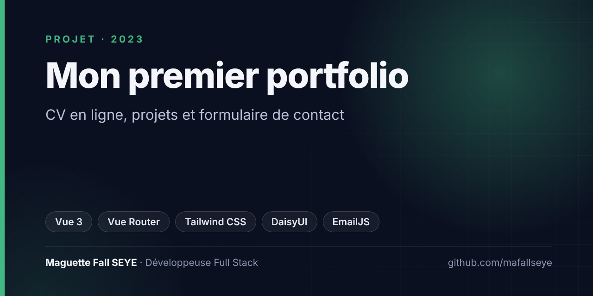
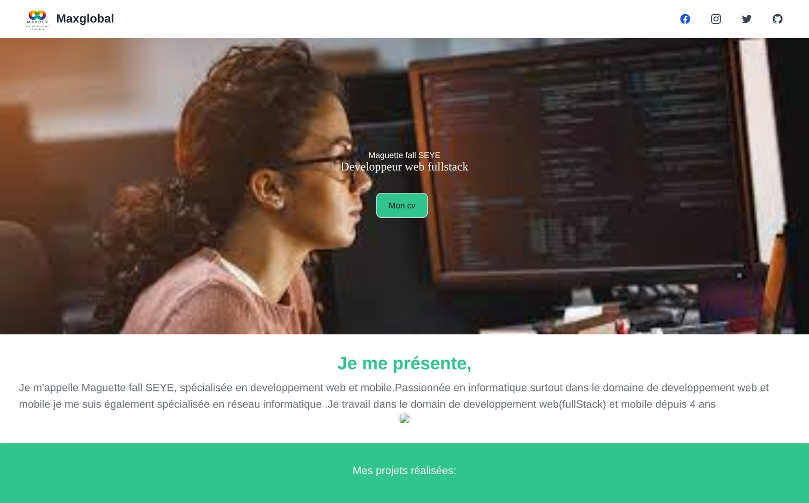

<p align="center"></p>

# Mon premier portfolio

Mon premier portfolio en ligne : CV, projets et formulaire de contact.

## Aperçu

<p align="center"><br><em>Page d'accueil</em></p>

## Fonctionnalités

- Pages Accueil, À propos, Projets et Contact
- Formulaire de contact par EmailJS
- CV téléchargeable

## Technologies

Vue 3 · Vue Router · Tailwind CSS · DaisyUI · EmailJS

## Lancer le projet

Prérequis : Node.js 16 ou plus.

```bash
git clone https://github.com/mafallseye/premierapp.git
cd premierapp
npm install
npm run serve
```

## Auteure

**Maguette Fall SEYE** — Développeuse Full Stack, Dakar (Sénégal) · [github.com/mafallseye](https://github.com/mafallseye)
